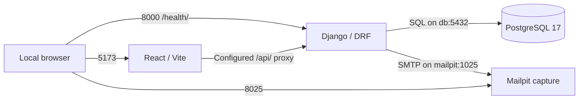

# Inventory & Sales Management SaaS

[](https://github.com/danipello09/inventory-sales-saas/actions/workflows/bootstrap-validation.yml)

A full-stack project building toward organization-scoped inventory and sales
management with React, Django REST Framework and PostgreSQL. It is also a
professional portfolio demonstrating architecture decisions, reproducible
development and evidence-based pull request review.

**Current stage: Phase 3 — identity and catalog backend (catalog under review).**
The repository runs a development environment and integration checks. It is not a
finished commercial application and is not ready for production or real customer data.

## Purpose and implementation status

The intended product helps businesses track product variants, stock movements and
sales while keeping each organization's data separate. The catalog backend is now
implemented on this branch; stock/sales and their design-only routes remain planned.

| Available now | Planned, not implemented |
| --- | --- |
| Health plus registration, session login/logout and own-organization API | Email verification, recovery and abuse/rate limiting |
| Categories, products and variants API; React/TypeScript starter screen | Inventory, sales and commercial frontend |
| PostgreSQL, local email capture and four-service Compose environment | Commercial data model and cross-tenant tests for future business modules |
| Session/CSRF, ADMIN/STAFF and organization-isolation tests; five CI jobs | Invitations, business dashboards and production deployment |
| Approved architecture decisions and draft data/API contracts | Final business schema and commercial API endpoints |

Framework migrations are supplemented by UUID user, organization and membership
migrations. Identity and organization metadata APIs are implemented; there are no
stock, sales or registered admin routes. Catalog routes and constraints are documented
in [the catalog design](docs/architecture/product-catalog.md). See [the API guide](docs/development/identity-backend.md).

## Technology

| Area | Stack |
| --- | --- |
| Backend | Python 3.12, Django 5.2, Django REST Framework, psycopg |
| Frontend | Node.js 22, React 19, TypeScript, Vite |
| Database | PostgreSQL 17 for integrated development and CI; SQLite for standalone smoke checks |
| Local services | Docker Compose, Mailpit SMTP capture |
| Quality | pytest, Ruff, Vitest, ESLint, TypeScript build, GitHub Actions |

Exact packages are recorded in [backend requirements](backend/requirements.txt),
the [frontend manifest](frontend/package.json) and its committed lockfile.
Dockerfiles and [Compose](compose.yaml) specify image versions.

## Architecture

The repository uses a monorepo with a Django backend and a React frontend. The
backend is intended to evolve into a modular monolith, following the
[approved ADR/TD decisions](docs/adr/README.md).



This diagram shows the local topology. The proxy and SMTP transport are configured;
business requests and invitation delivery are future work. PostgreSQL uses a named
volume and has no published host port. A shared database with logical organization
isolation, session cookies, CSRF protection and same-origin deployment are approved
design choices. The current slice implements identity and scoped organization
metadata only; business modules and their isolation tests remain pending.

## Repository layout

```text
.github/                 PR template and GitHub Actions workflow
backend/                 Django settings, health endpoint, tests and Dockerfile
frontend/                React source, npm lockfile, tooling and Dockerfile
docs/adr/                Approved architecture and technical decisions
docs/architecture/       Draft data model and API contract (design only)
docs/development/        Setup, Docker, CI and issue validation reports
docs/study/              Spanish learning and interview notes
compose.yaml             Four-service local development topology
.env.example             Nonsecret configuration template
CONTRIBUTING.md          Contribution and review workflow
SECURITY.md              Development security and reporting guidance
```

## Quick start with Docker Compose

**The old Phase 2 PostgreSQL volume is incompatible with accounts.User. Keep it
intact. Do not run this checkout with the old/default Compose project.** Follow
[the safe cutover procedure](docs/development/identity-cutover.md), which creates a
new named project and new named volume without reading the old .env.

Requirements: Git, Python 3.12 and a running Docker Linux engine with Compose v2+
(Windows: Docker Desktop/WSL 2). Host Node and Python packages are not required
for the standard-library startup helper. From this implementation checkout's root:

**Windows PowerShell:**

```powershell
py -3.12 scripts/start_identity_sandbox.py
```

**Linux Bash:**

```bash
python3.12 scripts/start_identity_sandbox.py
```

The helper chooses distinct loopback ports and fresh local credentials, builds
images, waits for four healthy services, migrates the new database and checks its
schema. It prints backend/frontend/Mailpit URLs and a private manifest containing
the exact project-specific Compose command prefix. Keep that manifest and sandbox.env
outside Git. Use that same prefix to resume/stop the environment; running the helper
again creates another fresh sandbox. Never use bare Compose commands for this cutover.
The DB has no published port. No user/data transfer from the old volume is performed.

Use `--verify` for the disposable cutover/HTTP/session/tenant regression procedure;
only that invocation's new test resources are removed. See the cutover guide for
reproduction, lifecycle commands and rollback to the unchanged old checkout.

## Run quality checks

With the new sandbox running, prefix every command below with the exact Compose
argv from its manifest, including its -f/--env-file/--project-name values. The entries
shown here are suffixes, not complete shell commands; never use the default project. See [cutover lifecycle](docs/development/identity-cutover.md#resume-inspect-and-stop-that-same-sandbox).

```text
exec -T backend python manage.py check
exec -T backend python -m ruff check .
exec -T backend python -m pytest -q
exec -T frontend npm run lint
exec -T frontend npm test
exec -T frontend npm run build
exec -T frontend npm audit --omit=dev --audit-level=low
exec -T frontend npm audit --audit-level=high
```

Tests cover identity/organization metadata and infrastructure, not future
catalog/inventory/sales behavior or production readiness. Tests use a separate test
database. Never point them at production.
The [standalone setup guide](docs/development/README.md) covers host Python/Node
development without Docker.

## Continuous integration and contributions

The real **Quality checks** workflow runs on PRs targeting `main`, pushes to `main`
and manual dispatch. Its five independent jobs check Django, React, PostgreSQL,
Compose configuration and npm vulnerabilities. It does not deploy the application
or build/start the complete Compose stack. See the [CI guide](docs/development/ci.md)
for commands, failure logs, audit thresholds, caches and limitations.

Read [CONTRIBUTING.md](CONTRIBUTING.md) before choosing an issue or opening a PR.
Review the five checks on the latest commit; a green badge on `main` is not evidence
that an unmerged branch passed. See [SECURITY.md](SECURITY.md) before sharing logs
or reporting a vulnerability. Keep services bound to loopback, use synthetic test
data, and never put credentials in browser-exposed `VITE_*` variables.

## Roadmap and further reading

The roadmap reflects the current implementation scope; it is not a release schedule.

| Stage | Status |
| --- | --- |
| Phase 2: architecture and infrastructure | Architecture decisions documented; Issues #4, #5 and #6 provide bootstrap, Docker and CI |
| Phase 2: onboarding and contribution documentation | Integrated via PR #13 |
| Phase 2: infrastructure/evidence review | Evidence integrated via PR #14; not a production sign-off |
| Identity slice | Design and implementation integrated via PR #15/#16 |
| Catalog slice | Category/product/variant backend implemented on its own review branch |
| Future implementation | Inventory, sales and their isolation/integrity tests; commercial frontend and public-exposure gates remain open |

- [Approved ADR and technical decisions](docs/adr/README.md)
- [Conceptual data model](docs/architecture/data-model.md) and [API outline](docs/architecture/api-contract.md)
- [Safe identity cutover](docs/development/identity-cutover.md) and [public-exposure follow-ups](docs/development/identity-public-exposure.md)
- [Development setup](docs/development/README.md), [Docker operations](docs/development/docker-compose.md) and [CI](docs/development/ci.md)
- [Spanish study guide](docs/study/development-workflow-es.md)
- Historical validation evidence: [Issue #4](docs/development/issue-4-validation.md), [Issue #5](docs/development/issue-5-validation.md), [Issue #6](docs/development/issue-6-validation.md), [Issue #7](docs/development/issue-7-validation.md)

Validation reports record what was observed on their dates; use the setup/CI guides
for current instructions and the latest PR checks for current execution results.
