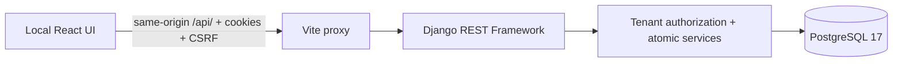

# Stockroom — Inventory & Sales Management MVP

A local portfolio project built with **React 19, TypeScript, Django 5.2 / Django REST
Framework and PostgreSQL 17**. It demonstrates a real workflow:

**Sign in → create a product with variants → add 10 units → sell 3 → see 7 remaining.**

This is a learning and interview project assisted by AI, not a commercial SaaS or
production release. Do not enter real customer data or expose it to the internet.

[](https://github.com/danipello09/inventory-sales-saas/actions/workflows/bootstrap-validation.yml)

The badge reflects main. The local MVP has been integrated through PRs #16, #17 and #18.
The developer manually completed the 8/8 visual acceptance checklist; the prior
browser-automation blocker remains documented as historical evidence in
[MVP progress](docs/development/mvp-progress.md).

## What it does

- Register an organization/ADMIN, sign in/out with sessions and CSRF.
- Create categories, products and one or more variants; paginate the catalog.
- ADMIN adjusts stock with a required reason. ADMIN/STAFF view balances and history.
- ADMIN/STAFF record sales with server-calculated Decimal totals and historical prices.
- Reject insufficient stock and inactive variants; roll back failed sales completely.
- Inspect sales and append-only movement history. ADMIN cancellation restores stock once.
- Keep organizations separate in API queries and related PostgreSQL data.
- React provides responsive forms, navigation, loading/empty/error states and a simple
  overview of product, variant and recorded-sale counts (not financial analytics).

No payments, complex taxes, invoicing, purchasing, warehouses, transfers, reservations,
returns, invitations or advanced reporting. No public deployment.

## Architecture and decisions



A modular monolith: `accounts`, `organizations`, `identity`, `catalog`, `inventory`,
`sales`. UUID business entities; one membership per user for the MVP. ADMIN manages
catalog/stock; STAFF may read and sell. Authenticated membership supplies tenant
identity, never a client organization_id. Foreign UUIDs return 404.

Sales lock variants/balances in UUID order, preserve price/SKU/currency snapshots,
and write stock movements in the same transaction. First balance creation occurs
under a variant lock. Organization-level serialization is an explicit MVP throughput
tradeoff. Composite PostgreSQL FKs protect cross-entity organization consistency;
they are not RLS. SQLite does not implement those locks/custom constraints.

Read [approved decisions](docs/adr/README.md), [catalog design](docs/architecture/product-catalog.md)
and [inventory/sales design](docs/architecture/mvp-inventory-sales.md). Only live
routes appear in [the API contract](docs/architecture/api-contract.md).

## Run locally with a NEW PostgreSQL sandbox

Requirements: Git, Python 3.12, Docker Desktop with Linux containers and Compose v2+.
The helper builds Python/Node dependencies inside containers. Host Node is optional.

**Keep the original Phase 2 Compose project and PostgreSQL volume intact.** Do not
run plain `docker compose up` with new code: its default project belongs to the old
environment. Never use `--fake`, prune volumes or attach a preexisting volume.
The legacy guard intentionally rejects databases with the old auth.User schema.

Clone/check out `main`, then from the repository root:

```powershell
py -3.12 scripts/start_identity_sandbox.py
```

```bash
python3.12 scripts/start_identity_sandbox.py
```

This verifies that a random project/volume is new, generates private local credentials,
binds services to loopback on fresh ports, checks actual database mounts and applies
27 migrations only to that new volume. It prints frontend/backend/Mailpit URLs and
a private manifest path. PostgreSQL has no host port in this Compose sandbox.

Open the **printed frontend URL**, not the original 5173 environment. Use “Create a
 demo workspace”, enter synthetic details and a strong demo password, then:

1. Products: add a category, create a product with SKU `DEMO-001`, price `12.50`.
2. Inventory: select that variant, unit change `10`, reason `Opening stock`.
3. New sale: Add the variant, change quantity to `3`, Confirm sale.
4. Sales history: inspect total `37.50` and the unit-price snapshot.
5. Inventory: verify stock `7` and movements `+10`, `-3`.
6. Sign out, register another organization and confirm its lists are empty.
7. Optional: as the first ADMIN, cancel the sale with a reason; stock returns to 10
   once. The original sale and compensating movements remain in history.

Never save demo passwords into repository files. Sessions/tokens are not stored in
localStorage. After login the API client refreshes Django's rotated CSRF token.

For stop/resume, use **exactly** the `compose_argv` prefix in your private manifest,
followed by `stop`, `start --wait`, or `ps`. Do not recreate a sandbox just to resume it.
Routine shutdown must not remove volumes. Full instructions:
[safe cutover](docs/development/identity-cutover.md).

## Tests and reproducible evidence

Create a backend venv and install `backend/requirements.txt` with Python 3.12.
From `backend`, with DATABASE_HOST unset (SQLite smoke/API checks):

```text
python manage.py check
python -m ruff check .
python manage.py makemigrations --check --dry-run
python -m pytest -q
```

SQLite intentionally skips PostgreSQL integrity/concurrency cases. Run the real DB
suite and a disposable-schema legacy rejection from the root using that venv Python:

```powershell
backend/.venv/Scripts/python.exe scripts/verify_identity_database.py
py -3.12 scripts/start_identity_sandbox.py --verify --catalog
```

Linux: `backend/.venv/bin/python scripts/verify_identity_database.py`, then
`python3.12 scripts/start_identity_sandbox.py --verify --catalog`.
Each verifier owns only new resources and cleans up only its own disposable stack.
The second command now also verifies inventory/sales `10 - 3 = 7` with real HTTP.

Frontend (Node 22.18+ recommended, or a version accepted by frontend/package.json):

```text
cd frontend
npm ci
npm run lint
npm test
npm run build
```

From the root, against a NEW retained sandbox's printed frontend URL:

```text
node scripts/verify_mvp_transport.mjs http://127.0.0.1:<new-frontend-port>
```

This executes the actual TypeScript API client through Vite with real HTTP/cookies;
it is a transport integration check, not a visual browser test. It creates synthetic
organizations in that new sandbox. Do not point it at the old/default environment.
The earlier browser-automation limitation remains recorded in
[historical validation/progress](docs/development/mvp-progress.md); the developer
subsequently confirmed completing the 8/8 manual visual checklist.

Five existing CI jobs remain: Django checks, React checks, PostgreSQL integration,
Docker Compose validation, npm dependency audit. See [CI policy](docs/development/ci.md).

## Repository and learning map

| Location | Responsibility |
| --- | --- |
| backend/identity/ | Sessions, CSRF and centralized organization authorization |
| backend/catalog/ | Categories, products, variants and catalog integrity |
| backend/inventory/ | Balances, movements, adjustments and PostgreSQL tenant FKs |
| backend/sales/ | Sales, item snapshots, atomic sale and idempotent cancellation |
| frontend/src/App.tsx | Local portfolio UI and forms |
| frontend/src/api.ts | Typed session/CSRF transport |
| scripts/ | New-resource-only sandbox and database verification |
| docs/study/ | Spanish explanations tied to real code |

For a concise portfolio pitch, real demo script and seven-session study route, read
[portfolio-demo-and-interview-plan-es.md](docs/study/portfolio-demo-and-interview-plan-es.md).

Start with [interview-preparation-es.md](docs/study/interview-preparation-es.md):
20 topics, real code references, Spanish/English answers, exercises without AI and
an honest 60–90 second English introduction. [Catalog study notes](docs/study/product-catalog-es.md)
provide more detail on relational tenant integrity.

## Limits and security

**Not production-ready.** Rate limiting/abuse controls, email ownership verification,
account recovery and reviewed production settings/deployment are still OPEN
[public-exposure gates](docs/development/identity-public-exposure.md).
Development Compose/runserver/Mailpit are local tools, not production infrastructure.

No SQL RLS, trusted-SQL append-only enforcement, request idempotency keys, realtime
multi-tab synchronization, backup/restore solution or load benchmark. On an uncertain
network outcome, inspect sale/stock history before retrying a non-idempotent POST.
Custom DDL needs PostgreSQL tests when related columns change. API money rejects
excess precision; direct SQL numeric typmod may round. Nine moderate development
npm findings are existing debt; passing the audit threshold does not mean zero risk.

See [SECURITY](SECURITY.md), [contributing](CONTRIBUTING.md) and the versioned
[MVP design/limits](docs/architecture/mvp-inventory-sales.md). No issues are closed
by this documentation update.
