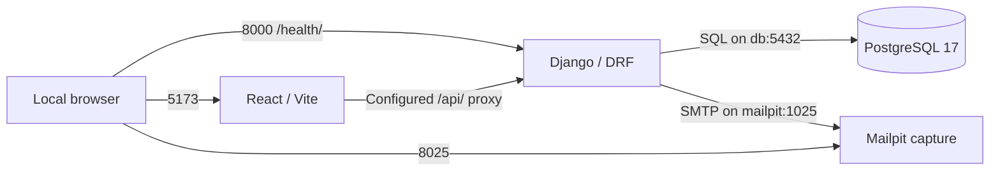

# Inventory & Sales Management SaaS

[](https://github.com/danipello09/inventory-sales-saas/actions/workflows/bootstrap-validation.yml)

A full-stack project building toward organization-scoped inventory and sales
management with React, Django REST Framework and PostgreSQL. It is also a
professional portfolio demonstrating architecture decisions, reproducible
development and evidence-based pull request review.

**Current stage: Phase 2 — architecture and infrastructure.** The repository runs
a development environment and smoke checks. It is not a finished commercial
application and is not ready for production or real customer data.

## Purpose and implementation status

The intended product helps businesses track product variants, stock movements and
sales while keeping each organization's data separate. These business capabilities
are planned; their design documents do not mean the features exist.

| Available now | Planned, not implemented |
| --- | --- |
| Django JSON health endpoint at `/health/` | User registration, login and organization membership |
| React/TypeScript starter screen | Product catalog, variants, inventory and sales |
| PostgreSQL, local email capture and four-service Compose environment | Tenant-scoped authorization and isolation tests |
| Lint, smoke tests, build and five CI jobs | Invitations, business dashboards and production deployment |
| Approved architecture decisions and draft data/API contracts | Final business schema and commercial API endpoints |

The existing Django migrations belong to framework applications. There are no
business models, registered login/admin routes or commercial endpoints.
`/api/v1/` currently returns 404, including through Vite's configured `/api/` proxy.

## Technology

| Area | Stack |
| --- | --- |
| Backend | Python 3.12, Django 5.2, Django REST Framework, psycopg |
| Frontend | Node.js 22, React 19, TypeScript, Vite |
| Database | PostgreSQL 17 for integrated development and CI; SQLite for standalone smoke checks |
| Local services | Docker Compose, Mailpit SMTP capture |
| Quality | pytest, Ruff, Vitest, ESLint, TypeScript build, GitHub Actions |

Exact packages are recorded in [backend requirements](backend/requirements.txt),
the [frontend manifest](frontend/package.json) and its committed lockfile.
Dockerfiles and [Compose](compose.yaml) specify image versions.

## Architecture

The repository uses a monorepo with a Django backend and a React frontend. The
backend is intended to evolve into a modular monolith, following the
[approved ADR/TD decisions](docs/adr/README.md).



This diagram shows the local topology. The proxy and SMTP transport are configured;
business requests and invitation delivery are future work. PostgreSQL uses a named
volume and has no published host port. A shared database with logical organization
isolation, session cookies, CSRF protection and same-origin deployment are approved
design choices; application-level tenancy and authentication flows are pending.

## Repository layout

```text
.github/                 PR template and GitHub Actions workflow
backend/                 Django settings, health endpoint, tests and Dockerfile
frontend/                React source, npm lockfile, tooling and Dockerfile
docs/adr/                Approved architecture and technical decisions
docs/architecture/       Draft data model and API contract (design only)
docs/development/        Setup, Docker, CI and issue validation reports
docs/study/              Spanish learning and interview notes
compose.yaml             Four-service local development topology
.env.example             Nonsecret configuration template
CONTRIBUTING.md          Contribution and review workflow
SECURITY.md              Development security and reporting guidance
```

## Quick start with Docker Compose

You need Git, a running Docker Engine for Linux containers and Docker Compose v2
or newer. On Windows, use Docker Desktop with WSL 2. The first build needs network
access to download images and dependencies. Host Python and Node are optional
when all commands run inside containers.

Clone the repository, or enter your existing checkout. These Git commands work in
PowerShell and Bash:

```text
git clone https://github.com/danipello09/inventory-sales-saas.git
cd inventory-sales-saas
docker info
docker compose version
```

Create `.env` only if it does not already exist. **Windows PowerShell:**

```powershell
if (-not (Test-Path .env)) { Copy-Item .env.example .env }
```

**Linux Bash:**

```bash
if [ ! -e .env ]; then cp .env.example .env; fi
```

Before starting services, edit `.env` locally: replace both `replace-in-local-env`
values (`DJANGO_SECRET_KEY` and `POSTGRES_PASSWORD`) with distinct random values.
Keep the development database/user names and default ports for a first setup.
Never commit `.env`. See [security and configuration](SECURITY.md) for the
difference between local values and production secrets.

Run from the repository root in either shell, checking each command succeeds:

```text
docker compose config --quiet
docker compose build
docker compose up -d --wait --wait-timeout 120
docker compose exec backend python manage.py migrate --noinput
docker compose ps
```

The migration command initializes Django's framework tables; it does not create
business features. Healthy HTTP services alone do not prove migrations are applied.

| Service | Default local address |
| --- | --- |
| React / Vite | http://127.0.0.1:5173/ |
| Django health JSON | http://127.0.0.1:8000/health/ |
| Mailpit inbox | http://127.0.0.1:8025/ |
| Mailpit SMTP | `127.0.0.1:1025` (host); `mailpit:1025` (backend container) |
| PostgreSQL | `db:5432` inside Compose; no host port |

Host ports can be changed in `.env`; the URLs above assume the defaults. See
[Docker development](docs/development/docker-compose.md) for logs, readiness,
port conflicts, image rebuilds and safe lifecycle commands. Use `docker compose
stop` to pause services or `docker compose down` to remove containers while
retaining the named database volume. Do not add `--volumes` for routine shutdown.

## Run quality checks

With the services running, execute from the root (PowerShell or Bash):

```text
docker compose exec backend python manage.py check
docker compose exec backend python -m ruff check .
docker compose exec backend python -m pytest -q
docker compose exec frontend npm run lint
docker compose exec frontend npm test
docker compose exec frontend npm run build
docker compose exec frontend npm audit --omit=dev --audit-level=low
docker compose exec frontend npm audit --audit-level=high
```

These are infrastructure smoke checks, not complete business or tenant-isolation
coverage. Tests use a separate test database. Never point them at production.
The [standalone setup guide](docs/development/README.md) covers host Python/Node
development without Docker.

## Continuous integration and contributions

The real **Quality checks** workflow runs on PRs targeting `main`, pushes to `main`
and manual dispatch. Its five independent jobs check Django, React, PostgreSQL,
Compose configuration and npm vulnerabilities. It does not deploy the application
or build/start the complete Compose stack. See the [CI guide](docs/development/ci.md)
for commands, failure logs, audit thresholds, caches and limitations.

Read [CONTRIBUTING.md](CONTRIBUTING.md) before choosing an issue or opening a PR.
Review the five checks on the latest commit; a green badge on `main` is not evidence
that an unmerged branch passed. See [SECURITY.md](SECURITY.md) before sharing logs
or reporting a vulnerability. Keep services bound to loopback, use synthetic test
data, and never put credentials in browser-exposed `VITE_*` variables.

## Roadmap and further reading

The roadmap reflects the current Phase 2 issue scope; it is not a release schedule.

| Stage | Status |
| --- | --- |
| Phase 2: architecture and infrastructure | Architecture decisions documented; Issues #4, #5 and #6 provide bootstrap, Docker and CI |
| Phase 2: onboarding and contribution documentation | Issue #7, delivered through review |
| Phase 2: infrastructure/evidence sign-off | Issue #8 remains a separate review task |
| Future implementation | Finalize model/API details, then implement the approved authentication, tenant isolation, catalog, inventory and sales design after Phase 2 review |

- [Approved ADR and technical decisions](docs/adr/README.md)
- [Conceptual data model](docs/architecture/data-model.md) and [API outline](docs/architecture/api-contract.md)
- [Development setup](docs/development/README.md), [Docker operations](docs/development/docker-compose.md) and [CI](docs/development/ci.md)
- [Spanish study guide](docs/study/development-workflow-es.md)
- Historical validation evidence: [Issue #4](docs/development/issue-4-validation.md), [Issue #5](docs/development/issue-5-validation.md), [Issue #6](docs/development/issue-6-validation.md), [Issue #7](docs/development/issue-7-validation.md)

Validation reports record what was observed on their dates; use the setup/CI guides
for current instructions and the latest PR checks for current execution results.
